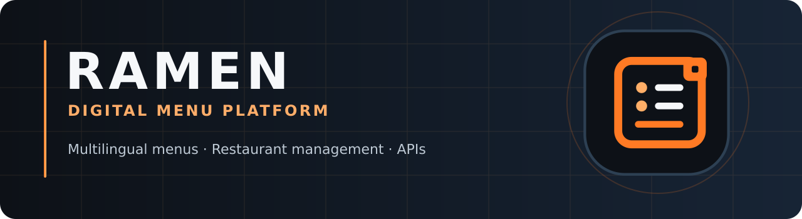

# RAMEN design system — proposed brand assets

**Brand:** RAMEN (رامن) · **GitHub repository:** Online-Menu.

The identity represents a **software platform for restaurant menus**, not one specific restaurant, noodle shop or food brand. The square mark combines a menu/list motif with a small QR-like visual detail. It is an illustrative mark, **not** a functioning QR code.

## Visual identity

| Token | Value | Use |
| --- | --- | --- |
| Dark | `#0D1117` | Dark backgrounds |
| Surface | `#172435` | Supporting panels |
| Orange | `#FF7A24` | Primary brand accent |
| Peach | `#FFAE67` | Secondary accent |
| White | `#F6F8FA` | Text |
| Muted | `#9BAABE` | Secondary text |

## Vector sources

- `assets/branding/ramen-mark.svg` — square vector icon.
- `assets/branding/ramen-logo-dark.svg` — horizontal wordmark on a dark background.
- `assets/branding/ramen-logo-light.svg` — horizontal wordmark on a white background.
- `assets/branding/ramen-github-cover.svg` — GitHub repository banner.

## Deployment precautions

- The admin login artwork and admin browser icon can use the platform mark. Restaurant-specific logo and content should remain separate and tenant-configurable.
- **Do not** overwrite existing PNG PWA assets in this PR. The corresponding PNG icon set must be visually reviewed and uploaded/referenced together in a separate tested migration.
- Inspect the mark at 32px, 192px, 512px and with browser maskable-icon safe-zone cropping.
- Do not rename legacy `romano-*` functions, storage keys, DOM selectors, database identifiers, or historical releases as part of a visual change.
- Production deployment, email, authentication and business functionality are not certified by this brand proposal.

## Next approval gate

Confirm the mark, color palette, and wordmark. After approval, upload correctly sized PNG assets and update the PWA manifest and favicons in the same tested changeset.
