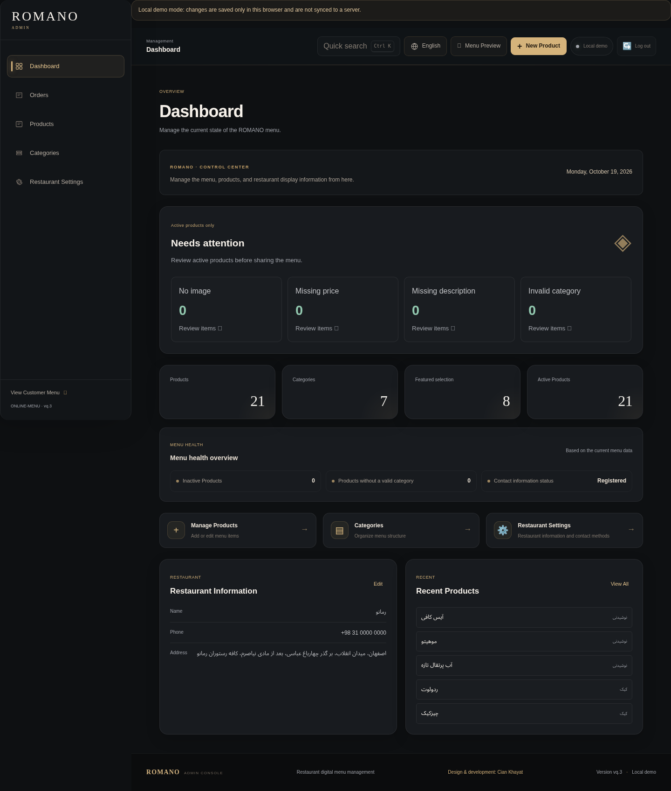
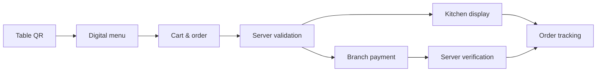
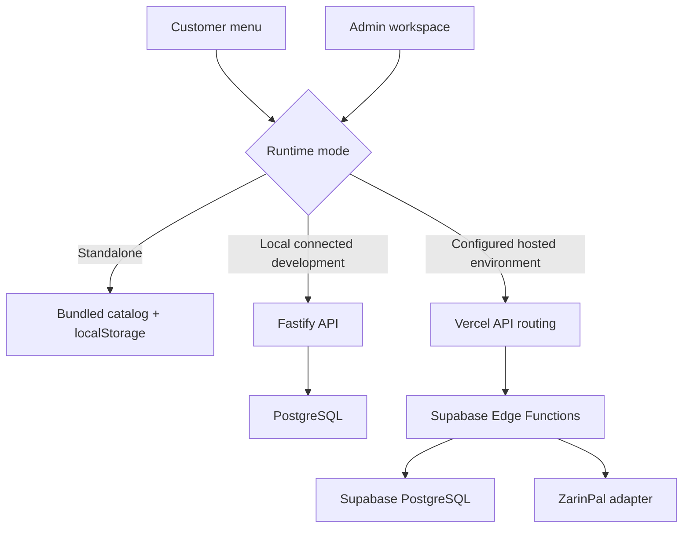

<div align="center">


# RAMEN · Online Menu

**From the first scan to the last bite.**

A multilingual digital dining experience.<br />
Designed for guests. Built for restaurant teams.

[](package.json)
[](#quick-start)
[](#four-languages-one-experience)

[](https://github.com/cianium/Online-Menu/actions/workflows/ci.yml)
[](#quick-start)
[](#technology)
[](#quality-engineering)

[**Quick start**](#quick-start) · [Product gallery](#product-gallery) · [Features](#product-capabilities) · [Architecture](#architecture) · [Documentation](#documentation)

[English](#english) · [فارسی](#فارسی) · [العربية](#العربية) · [Türkçe](#türkçe)

</div>

---

## English

**A menu worth exploring. A workspace worth working in.**

RAMEN brings together a visual, mobile-first guest menu and a dedicated restaurant management workspace. Its standalone demo makes the product easy to explore without a database or cloud account. A separate connected implementation provides the foundation for signed table QR sessions, ordering, kitchen workflows and direct branch payments.

<table>
<tr>
<td width="50%" valign="top">
<h3>01 · The guest experience</h3>
<p>Discover dishes, search the catalog, browse categories, switch languages, explore favorites and build a cart.</p>
</td>
<td width="50%" valign="top">
<h3>02 · The restaurant workspace</h3>
<p>Manage sample products, prices, categories and restaurant content. Evaluate connected operational features separately.</p>
</td>
</tr>
</table>

## Product gallery

<p align="center"></p>

<table>
  <tr>
    <td width="70%" align="center"><b>Restaurant workspace</b></td>
    <td width="30%" align="center"><b>Mobile management</b></td>
  </tr>
  <tr>
    <td valign="top"></td>
    <td valign="top"></td>
  </tr>
  <tr>
    <td>Desktop · English · LTR</td>
    <td>Mobile · فارسی · RTL</td>
  </tr>
</table>

*Actual screenshots tracked from earlier browser QA, not freshly captured from the current revision. The restaurant photograph is a real project asset, not a customer UI screenshot.*

[**View the successful real product capture**](https://github.com/cianium/Online-Menu/actions/runs/45646282827) · [Download screenshots, GIF and social cover](https://github.com/cianium/Online-Menu/actions/runs/45646282827/artifacts/15037593433) · [Regenerate media](docs/showcase/README.md)

The showcase job captures the current standalone menu and admin workspace in Chromium with all external requests blocked. Its artifact contains customer/admin screenshots, an animated walkthrough, a social preview PNG and revision provenance. No production deployment or real merchant data is involved. The linked artifact was generated at revision `5447926b` and expires on 25 December 2026; sign-in may be required. Regenerate it from the workflow for newer revisions.

---

## Product capabilities

| Capability | Standalone demo | Connected implementation |
| :--- | :---: | :---: |
| Visual catalog, categories and search | Available | Included |
| Favorites and cart experience | Available | Included |
| Four languages and RTL/LTR | Available | Included |
| Catalog management and local persistence | Available | Server-backed catalog |
| Multi-branch sample workspaces and table QR links | Browser-local, standalone export | Configured branches and signed sessions |
| Branch activation and all-branch business-data backup | Available in standalone export | Separate server operations required |
| Signed table QR sessions | — | Configuration required |
| Server-authoritative orders and tracking | — | Configuration required |
| Order queue and kitchen display (KDS) | — | Configuration required |
| Direct branch payment via ZarinPal | — | Merchant setup & validation |
| Server-side roles and tenant isolation | — | Staging validation required |

**Connected** means the implementation exists in the source, not that a production service is active or certified. The local Fastify API is not assumed to have full parity with hosted commerce APIs.

## Public standalone demo

[Open customer entry](https://cianium.github.io/Online-Menu/?qr=demo) · [Open the demo admin workspace](https://cianium.github.io/Online-Menu/admin/) · [Published source identity](https://cianium.github.io/Online-Menu/VERSION.json)

`pages-demo` contains the public standalone snapshot. `main` is the canonical source branch. Match a published build to its source with `VERSION.json`. See the [R16 candidate notes](docs/releases/R16_CANDIDATE_FA.md) for the current development track and verified revision evidence. The public site is for sample data only, not a private staff login, real payment service or shared customer database. Customer entry uses a fictional name and phone number. Demo admin credentials are `demo-admin` / `Demo-Only-2026`; these public values are not real authentication.

The standalone release gates cover Node tests, PostgreSQL contracts, Edge Function type checks, Chromium/Firefox/WebKit flows, four-language responsive views and automated accessibility scans. They do not certify the optional connected Supabase/Vercel services, real payments, native Safari or field Core Web Vitals. Historical showcase images retain their own revision provenance.

## Quick start

> [!TIP]
> **The fastest way to experience RAMEN:** Git and Node.js 22+ are all you need. No dependency installation, database, cloud account or API credentials are required for the standalone demo.

Prerequisites: Git and Node.js 22+ (with npm).

```bash
git clone https://github.com/cianium/Online-Menu.git
cd Online-Menu
npm run demo
```

| Open in your browser | What to explore |
| :--- | :--- |
| [127.0.0.1:8765/](http://127.0.0.1:8765/) | Customer menu |
| [127.0.0.1:8765/admin/](http://127.0.0.1:8765/admin/) | Local admin workspace |

The included Node.js preview server binds only to loopback and serves the public application files. No dependency installation is needed for this demo command. The frontend can use bundled catalog data and browser storage instead of a remote API.

**A five-minute product tour**

1. Open the customer menu and browse the sample catalog.
2. Switch languages, search and explore the menu on a narrow viewport.
3. Open the admin panel in another tab and add a sample product.
4. Return to the customer tab and observe the local catalog update.
5. Reload both tabs to explore browser-local persistence.

> [!NOTE]
> The standalone demo is for evaluation, not a production admin login or a shared database. Use sample data only. Changes remain in the current browser/origin; real table sessions, order fulfillment and payments require the connected services. Fonts and sample imagery are bundled locally, so the core demo does not depend on third-party assets.

In the standalone export, the admin can create and rename sample branches, assign table QR links, deactivate/reactivate non-primary branches from the primary workspace and export business data for all branches. Full restore requires an empty browser profile and other tabs closed; backups contain personal information and must remain private. These browser-local operations are not server-side tenant isolation or cross-device QR ordering.

### Export a private demo for a future VPS

<details>
<summary><strong>Build and verify a portable static bundle</strong></summary>

Create a portable static bundle without deploying anything:

```bash
npm run qa
npm run demo:export
cd dist/demo/public
sha256sum -c ../SHA256SUMS
```

The export writes only the public application assets plus a separate SHA-256 manifest. It does not overwrite an existing bundle, install a web server or publish the site. The private export marks the customer page as noindex and disables the public PWA cache behavior. These measures do not replace authentication: a future private VPS demo requires HTTPS and access control for both interfaces.

See [local demo guidance](docs/DEMO_LOCAL.md) and the [VPS demo checklist (FA)](docs/VPS_DEMO_FA.md) before sharing or installing the bundle.

</details>

## The experience

### 01 — A menu made for discovery

An image-led, responsive customer interface with search, category filters, favorites and language switching. In connected mode, eligible table sessions can also use the cart, submit orders and track their status.

### 02 — A workspace for the team

A dedicated admin interface for catalog management. The local demo supports editing and persisting the sample catalog; the connected admin layer adds authentication, restaurant-scoped permissions, media management and operational controls.

### 03 — From table to kitchen

The vq.3 commerce source includes signed table QR sessions, server-priced orders, an order queue and kitchen display (KDS), and a branch-level ZarinPal payment adapter. The intended settlement model routes payment directly through the branch merchant account rather than holding restaurant funds on the platform. These flows need real server configuration and staging validation before use with guests.



*Connected-mode concept: the exact ordering and payment path depends on branch configuration.*

## Four languages, one experience

<table>
<tr>
<td align="center" width="25%"><strong>فارسی</strong><br /><sub>Persian · FA · RTL</sub></td>
<td align="center" width="25%"><strong>العربية</strong><br /><sub>Arabic · AR · RTL</sub></td>
<td align="center" width="25%"><strong>English</strong><br /><sub>EN · LTR</sub></td>
<td align="center" width="25%"><strong>Türkçe</strong><br /><sub>TR · LTR</sub></td>
</tr>
</table>

Both the customer and admin applications include localization support. The standalone browser test exercises all four locales at 320, 768 and 1440 pixel viewport widths.

## Architecture

The frontend uses HTML, CSS and vanilla JavaScript. The repository contains two distinct connected backend paths in addition to the standalone preview.



The Fastify and hosted Supabase paths are not assumed to have identical capabilities. The hosted commerce implementation lives in the Edge Functions and associated database migrations.

### Technology

<div align="center">


</div>

| Layer | Technology |
| :--- | :--- |
| Customer & admin | HTML5 · CSS3 · vanilla JavaScript |
| Demo | Node.js HTTP server · localStorage · bundled data |
| Local API | Fastify · Node.js · PostgreSQL |
| Hosted API | Supabase Edge Functions · Deno · TypeScript |
| Database | PostgreSQL 17 in commerce migration QA |
| Hosting configuration | Vercel routing and security headers |
| Quality | Node test runner · Playwright · GitHub Actions |

<details>
<summary><strong>Explore the repository structure</strong></summary>

```text
Online-Menu/
├── index.html                 # Guest application
├── js/                        # Menu, locale and commerce logic
├── css/                       # Customer styles
├── assets/                    # Images and other static assets
├── admin/                     # Management workspace and KDS
├── backend/                   # Fastify API and local migrations
├── supabase/
│   ├── functions/             # Hosted public/admin/order/payment APIs
│   └── migrations/            # Database and commerce invariants
├── qa/                        # Static, contract and browser checks
├── docs/                      # Architecture and release guidance
├── .github/workflows/          # Continuous integration
├── docker-compose.yml         # Local PostgreSQL
└── package.json               # Demo and QA commands
```

</details>

## Connected local development

<details>
<summary><strong>Start the optional Fastify/PostgreSQL backend</strong></summary>

Use this path to explore the local Fastify/PostgreSQL backend. It is separate from the standalone demo and is not a complete substitute for hosted commerce staging.

Prerequisites: Node.js 22+, npm and Docker Compose (or a locally configured PostgreSQL instance).

```bash
npm --prefix backend ci
cp backend/.env.example backend/.env
docker compose up -d postgres
```

Edit `backend/.env` before continuing: configure the local `DATABASE_URL`, set `BOOTSTRAP_ADMIN_EMAIL` and choose a strong `BOOTSTRAP_ADMIN_PASSWORD` of at least 12 characters. Do not commit the file.

```bash
npm run backend:migrate
npm run backend:seed
npm run backend:start
```

Open [localhost:3000/](http://localhost:3000/) and [localhost:3000/admin/](http://localhost:3000/admin/). See the [backend guide](backend/README.md) for setup and security details.

</details>

## Quality engineering

The repository includes explicit quality gates for static assets, JavaScript/TypeScript syntax, backend contracts, demo isolation, browser behavior and database invariants.

| Command | Scope |
| :--- | :--- |
| `npm run qa` | Syntax, static audit, backend unit/contract and demo tests |
| `npm run qa:demo` | Local preview server, API client and static export contracts |
| `npm run qa:demo-browser` | Standalone customer/admin integration |
| `npm run qa:customer` | Customer browser scenarios |
| `npm run qa:browser` | Admin browser scenarios |
| `npm run qa:db` | PostgreSQL 17 commerce migration and smoke tests |
| `npm run qa:production` | Production preflight checks |

Browser suites require Playwright/Chromium and a suitable running preview. For the standalone suite, start `npm run demo` in one terminal, then run `npm run qa:demo-browser` in another with Playwright available. The database suite requires Docker.

[GitHub Actions](https://github.com/cianium/Online-Menu/actions) shows actual CI results. The CI workflow defines aggregate QA, PostgreSQL checks and Deno Edge Function type checks; the presence of a test or badge does not certify production operation.

## Security by design

The connected implementation is designed around explicit trust boundaries:

- Server-authoritative order pricing and signed, revocable table QR sessions.
- Tenant-scoped authorization, role checks and audit trails.
- Idempotent order/payment operations, concurrency checks and guarded payment transitions.
- Server-side payment verification and reconciliation of ambiguous payment attempts.
- Restricted access to sensitive data, security headers and server-only credentials.

Real tenant isolation, payment verification, recovery and deployment security must be validated in staging. Never put service-role keys, real merchant credentials or customer data into the demo, browser bundles or Git history.

Report vulnerabilities privately through the [security policy](SECURITY.md).

## Release and deployment

| Capability | Current source scope |
| :--- | :--- |
| Standalone customer and admin demo | Included; no mandatory backend |
| Static demo export for future private VPS hosting | Included; hosting and access controls not configured by export |
| Four-language catalog experience | Included in both interfaces |
| Local Fastify/PostgreSQL backend | Included; local setup required |
| QR ordering, KDS and branch payments | Connected implementation; feature flags and setup required |
| Production service availability | Requires independent verification |
| Live payment and merchant onboarding | Requires branch configuration and sandbox acceptance |

> [!IMPORTANT]
> The current source identifies itself as **vq.3 / 3.0.0**. This is not a claim that a specific live deployment has passed acceptance testing. The hosted migration path depends on an existing catalog schema baseline; do not assume an empty Supabase project can be bootstrapped from the commerce migrations alone.

The documented deployment target is [food.kiankhayat.me](https://food.kiankhayat.me). Its availability and deployed revision are not independently verified here.

Before enabling live ordering or payment, follow the [deployment guide](docs/DEPLOY_VQ3_FA.md), verify tenant isolation, configure currency conversion and signed table sessions, and validate PSP request/callback/retry handling in a controlled environment.

## Flagship library

Choose the material that fits your role: discover the product, evaluate the engineering, or prepare a restaurant pilot.

| For | Open the guide |
| :--- | :--- |
| Restaurant owners and customers | [Product catalog & seven-minute tour](docs/flagship/PRODUCT.md) |
| Guests and restaurant managers | [English](docs/flagship/en.md) · [فارسی](docs/flagship/fa.md) · [العربية](docs/flagship/ar.md) · [Türkçe](docs/flagship/tr.md) |
| Designers and marketing teams | [Brand guidelines](docs/flagship/BRAND.md) |
| Engineers and technical buyers | [System architecture & acceptance gates](docs/flagship/ENGINEERING.md) |
| Partners and investors | [Investor briefing](docs/flagship/INVESTOR.md) |
| Maintainers | [Release communication & approval checklist](docs/flagship/RELEASE.md) |

[Explore the complete library →](docs/flagship/README.md)

## Documentation

| Document | Purpose |
| :--- | :--- |
| [Product and market overview (FA)](docs/ONLINE_MENU_VQ3_FA.md) | Product positioning and commercial model |
| [Architecture](docs/ARCHITECTURE.md) | Architectural boundaries and target model |
| [API contract](docs/API_CONTRACT.md) | API routes, authorization and response conventions |
| [Product showcase](docs/showcase/README.md) | Brand cover, screenshot capture, animated tour and repository presentation |
| [Standalone demo](docs/DEMO_LOCAL.md) | Local startup, integration checks and demo limits |
| [Private VPS demo (FA)](docs/VPS_DEMO_FA.md) | Static export, checksum verification and future hosting |
| [Local backend](backend/README.md) | Setup, configuration and security model |
| [Deployment guide (FA)](docs/DEPLOY_VQ3_FA.md) | Hosted setup, preflight and acceptance |
| [vq.3 release notes (FA)](docs/releases/ONLINE_MENU_VQ3_FA.md) | Commerce changes and release requirements |
| [Release history audit](docs/RELEASES.md) | Historical tags and naming context |
| [Repository health — 2026-10-25](docs/REPOSITORY_HEALTH_2026-10-25.md) | Dated maintenance snapshot, not current CI status |
| [Security policy](SECURITY.md) | Private vulnerability disclosure |

## فارسی

<div dir="rtl" align="right">

<a href="docs/releases/R16_CANDIDATE_FA.md">یادداشت‌های کاندید R16</a>

**رامن (RAMEN)** یک منوی دیجیتال چندزبانه و محیط مدیریت رستوران است؛ از تجربه مشاهده منو برای مهمان تا مدیریت کاتالوگ، سفارش میز، صف آشپزخانه و پرداخت مستقیم شعبه در حالت متصل.

برای تجربه نسخه مستقل، کافی است پس از دریافت مخزن، دستور <code>npm run demo</code> را اجرا کنید. منوی مشتری و پنل مدیریت بدون نیاز به دیتابیس، حساب ابری یا کلید API قابل مشاهده هستند. تغییرات نمونه در مرورگر ذخیره می‌شوند. برای ساخت بسته مستقل نصب آینده روی VPS، دستور <code>npm run demo:export</code> در دسترس است؛ این دستور انتشار یا نصب روی سرور انجام نمی‌دهد.

پشتیبانی از فارسی، عربی، انگلیسی و ترکی در هر دو رابط وجود دارد. سفارش واقعی، پرداخت و مدیریت چندکاربره به پیکربندی سرور و تأیید محیط عملیاتی نیاز دارند.

[راهنمای کامل فارسی](docs/flagship/fa.md) · [راهنمای Demo و VPS](docs/VPS_DEMO_FA.md) · [راهنمای استقرار](docs/DEPLOY_VQ3_FA.md) · [معرفی محصول](docs/ONLINE_MENU_VQ3_FA.md) · [یادداشت انتشار](docs/releases/ONLINE_MENU_VQ3_FA.md)

</div>

## العربية

<div dir="rtl" align="right">

<strong>رامن؛ من أول مسح للرمز إلى آخر لقمة.</strong>

قائمة طعام رقمية متعددة اللغات ومساحة لإدارة المطعم، مع تجربة مصممة للهواتف وإدارة المنتجات والفئات والأسعار. يمكن تشغيل العرض المستقل باستخدام <code>npm run demo</code> دون قاعدة بيانات أو حساب سحابي. يتطلب الطلب الحقيقي وشاشة المطبخ والدفع إعداد الخدمات المتصلة والتحقق منها.

<a href="docs/flagship/ar.md">دليل المنتج والمستخدم</a> · <a href="docs/releases/R16_CANDIDATE_FA.md">ملاحظات الإصدار المرشّح R16 (بالفارسية)</a>

</div>

## Türkçe

**RAMEN — İlk taramadan son lokmaya.**

Mobil öncelikli, çok dilli dijital menü ve restoran yönetim alanı. Ürünleri, kategorileri ve fiyatları keşfedin ve yönetin. Bağımsız demo `npm run demo` komutuyla veritabanı veya bulut hesabı olmadan çalışır. Gerçek masa siparişi, mutfak ekranı ve ödeme için bağlantılı hizmetlerin yapılandırılması ve doğrulanması gerekir.

[Türkçe ürün ve kullanıcı rehberi](docs/flagship/tr.md) · [R16 aday sürüm notları (Farsça)](docs/releases/R16_CANDIDATE_FA.md)

---

## Project identity and licensing

**RAMEN** is the current product brand. **Online-Menu** is the repository name. Legacy `ROMANO` identifiers remain in the code and infrastructure contracts for compatibility.

This is a public source repository with no selected open-source license at the time of this documentation update. Public visibility does not grant permission to copy, modify, redistribute or commercially use the code beyond applicable rights.

---

<div align="center">

### RAMEN

**A better digital dining experience starts at the table.**

Maintained by [Kian Khayat · @cianium](https://github.com/cianium)

[Repository](https://github.com/cianium/Online-Menu) · [Issues](https://github.com/cianium/Online-Menu/issues) · [Actions](https://github.com/cianium/Online-Menu/actions) · [Releases](https://github.com/cianium/Online-Menu/releases)

</div>
