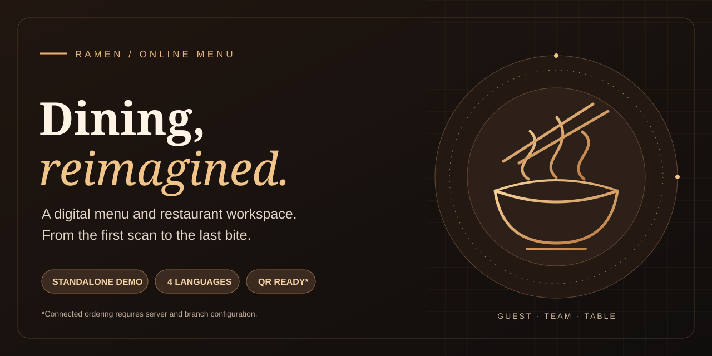

# RAMEN / Brand guidelines

> Proposed presentation identity, scoped to repository and marketing materials. This document does not authorize a product UI redesign or a trademark claim.

## Brand foundation

**Brand:** RAMEN · **Repository:** Online-Menu · **Legacy technical identifiers:** ROMANO.

**Positioning:** a digital dining experience built around guests and restaurant teams.

**Primary tagline:** From the first scan to the last bite.  
**Editorial headline:** Dining, reimagined.

| Voice | Do | Avoid |
| --- | --- | --- |
| Confident | Describe real benefits and concrete workflows | Superlatives without evidence |
| Welcoming | Explain the guest and team experience plainly | Unnecessary technical jargon |
| Precise | Label demo, connected source and verified operation | Calling a demo production-ready |
| International | Respect language and reading direction | Literal translations that break local meaning |

## Presentation palette

These proposed editorial colors are taken from the showcase cover, not a claim about every CSS token in the application.

| Role | Hex | Use |
| --- | --- | --- |
| Espresso | `#100E0D` | Main dark canvas |
| Warm charcoal | `#211610` | Secondary background |
| Cream | `#FFF4E5` | Main heading and text |
| Amber | `#F1C58A` | Accent headlines and highlights |
| Copper | `#B8753C` | Decorative accents; check contrast before using for text |
| Muted cream | `#E3D6C8` | Supporting text |

Use generous negative space and one primary accent. Verify WCAG contrast in the final design; never communicate errors or success by color alone.

## Typography and composition

- Editorial headings: Georgia or a licensed serif appropriate to the language.
- Functional text: system sans-serif; choose a suitable Arabic/Persian fallback for RTL.
- Use the existing product typography for actual screenshots. Do not redistribute font files without a valid license.
- Keep cover headline, value proposition and call to action distinct. Do not squash, rotate or recolor the cover arbitrarily.
- For Arabic and Persian, use proper shaping, mirrored layout where relevant and native punctuation; do not mirror logos, numbers or code.

## Imagery

Use real, permission-cleared food photography and actual captures of the product. Label prior QA evidence and illustrative artwork. Never insert a fictional payment success, invented merchant branding or personal data into a screenshot.

Social cover: 1280 × 640; keep important text away from edges. For mobile screenshots, show the full viewport rather than stretching it; use captions and alt text. Keep animated content optional; provide still images for users who prefer reduced motion.

## Language toolkit

| Language | Suggested editorial tagline |
| --- | --- |
| English | From the first scan to the last bite. |
| فارسی | از اولین اسکن تا آخرین لقمه. |
| العربية | من أول مسح للرمز إلى آخر لقمة. |
| Türkçe | İlk taramadan son lokmaya. |

Localize copy for the intended market; obtain native-speaker review before publishing commercial translations.

## Assets and governance

The editable [cover SVG](../showcase/cover.svg) and the [capture kit](../showcase/README.md) are versioned. The generated social PNG is available from the showcase workflow. The owner approves any logo redesign, public identity changes, licensing or trademark use. Existing ROMANO technical contracts are not renamed by this documentation.

[Product catalog](PRODUCT.md) · [Flagship library](README.md)
