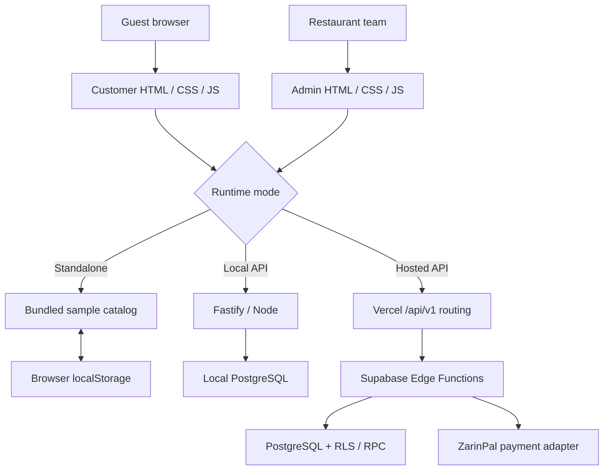
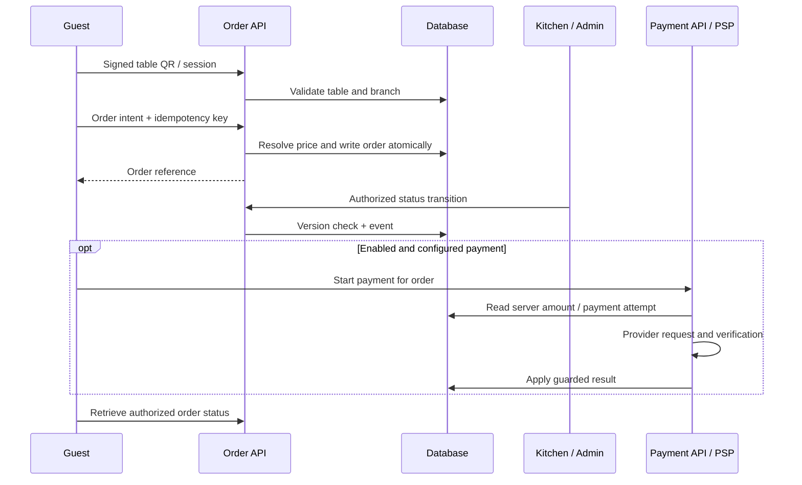

# RAMEN / Engineering brief

The frontend is shared across runtime modes, but the trust boundaries and capabilities differ. This is a source architecture overview, not a production security attestation.

## System context

### Runtime boundaries

| Concern | Standalone | Local connected API | Hosted connected |
| --- | --- | --- | --- |
| Data | Sample catalog / localStorage | PostgreSQL | Supabase PostgreSQL |
| Identity | Not real authentication | Server sessions and membership | Hosted authorization contracts |
| Orders/payment | No real fulfillment or payment | Do not assume hosted commerce parity | Commerce source and branch flags |
| Delivery | Loopback server or private static export | Fastify HTTP server | Configured Vercel/Edge routes |

The browser may request optional fonts; fallback styles keep the demo usable. The private static export is not a production API server.

## Connected order and payment sequence

Conceptual sequence only; exact endpoints and valid state transitions are defined by source and [API contract](../API_CONTRACT.md). The kitchen and payment timelines are independent and branch configuration governs availability.

## Risk controls and release evidence

| Risk | Source control or acceptance requirement |
| --- | --- |
| Cross-tenant data exposure | Server membership checks and RLS; staging isolation test |
| Modified browser prices | Server-authoritative amount and currency mapping |
| Duplicate requests | Idempotency, guarded attempts, concurrency checks |
| Ambiguous payment | Reconciliation rather than blind retry |
| Exposed secrets | Server-only configuration; scan public assets and exported bundle |
| Stale deployment | Record revision, smoke test, rollback plan |
| Data loss | Backup/restore rehearsal before migration |

Run `npm run qa`, `npm run qa:db`, and browser suites with Playwright as documented in the root README. The database fixture does not replace a real catalog schema baseline. The demo browser suite does not prove live payment, real tenant isolation or PWA offline-cache behavior.

## Go/no-go gates

- **Demo:** no production credentials; localhost preview works; protected export checksum matches; fresh browser context, four languages and widths verified.
- **Private VPS:** approved installation, TLS, access control, restricted web root, API 404 checks and rollback; do not rely on robots/noindex for security.
- **Connected pilot:** migration baseline reviewed, backup/restore rehearsed, branch currency and tables configured, signed QR validated, tenant isolation verified, PSP sandbox callbacks tested.
- **Public launch:** explicit owner approval, current deployment verification, monitoring, operational support, incident and rollback ownership.

[Architecture source notes](../ARCHITECTURE.md) · [Local backend](../../backend/README.md) · [VPS guide](../VPS_DEMO_FA.md) · [Deployment guide](../DEPLOY_VQ3_FA.md) · [Security policy](../../SECURITY.md)
