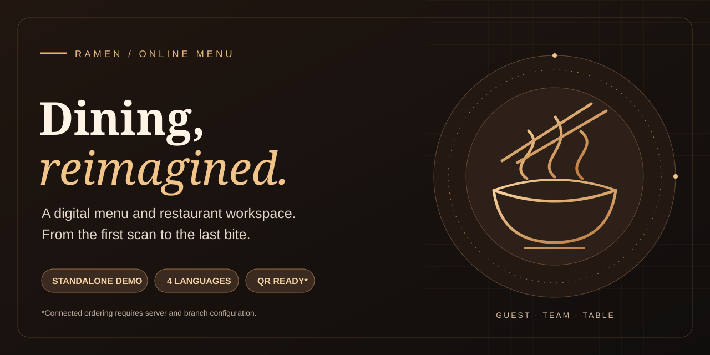

# RAMEN / Product catalog

**A menu guests enjoy. A workspace teams can operate.**

## A digital experience for hospitality

For restaurants, cafés and multi-branch operators, RAMEN connects menu discovery with catalog management and provides a foundation for connected table service. The independent demo lets decision-makers explore the experience before committing to infrastructure.

| Experience | Value proposition | Availability |
| --- | --- | --- |
| Visual menu | Browse dishes, categories, search and favorites from a phone | Standalone demo |
| Four languages | Serve Persian, Arabic, English and Turkish audiences with RTL/LTR layouts | Standalone demo |
| Management workspace | Edit sample products, prices and categories; observe same-browser updates | Standalone demo |
| Private presentation | Export a static bundle with checksums for protected hosting | Export included; hosting separate |
| QR table service | Signed table sessions, server-priced order, tracking | Connected source; branch setup required |
| Kitchen operations | Order queue and kitchen display | Connected source; validation required |
| Direct branch payment | ZarinPal adapter with server verification | Connected source; merchant and sandbox acceptance required |
| Multi-restaurant operation | Server-side memberships and tenant boundaries | Connected source; isolation acceptance required |

## A guided demonstration

| Time | Show | Explain |
| --- | --- | --- |
| 0:00–1:00 | Mobile menu, categories and dish details | Guests can explore without an app installation |
| 1:00–2:00 | Switch between RTL and LTR languages | The interface adapts to the selected locale |
| 2:00–3:00 | Search, favorites and cart | Real checkout is not performed in demo mode |
| 3:00–5:00 | Add a sample product in admin, inspect guest tab | Local persistence and catalog synchronization |
| 5:00–6:00 | Show the connected architecture and feature matrix | Explain deployment, branch setup and payment gates |
| 6:00–7:00 | Discuss the restaurant's menu and pilot requirements | Agree on next steps, not a production guarantee |

Start using [the four-language user guide](README.md). See the [actual captured showcase](https://github.com/cianium/Online-Menu/actions/runs/45645429531) for a prior successful standalone capture. Screenshots and GIF are provided as workflow artifacts, not a live service.

## Restaurant onboarding proposal

1. Collect the restaurant's authorized branding, menu categories, product photographs, prices, currencies and required translations.
2. Present a private sample catalog without personal or financial data; confirm design and language quality.
3. If the restaurant wants connected ordering, agree on a separate pilot scope, infrastructure, authorized staff, table setup, support and payment provider responsibilities.
4. Validate the catalog, tenant isolation, backup/restore, signed QR, order lifecycle and sandbox payment before any public launch.
5. Obtain approval and document operational ownership, rollback and ongoing support.

## Commercial scope

A proposed commercial model is a subscription for software, with optional setup, catalog migration, photography and integrations. Pricing, service levels, delivery commitments and payment terms require an approved agreement. No price or performance guarantee is made in this catalog.

Loyalty, POS synchronization, kitchen printing, delivery and advanced integrations are roadmap candidates; they are not included as delivered functionality. RAMEN is not a full ERP, and the demo does not process payments.

## Contact

Project maintainer: [@cianium](https://github.com/cianium). Discuss a demonstration or pilot through an agreed contact channel; do not post sensitive restaurant data in public issues.

[Brand guidelines](BRAND.md) · [Engineering](ENGINEERING.md) · [Investor briefing](INVESTOR.md)
