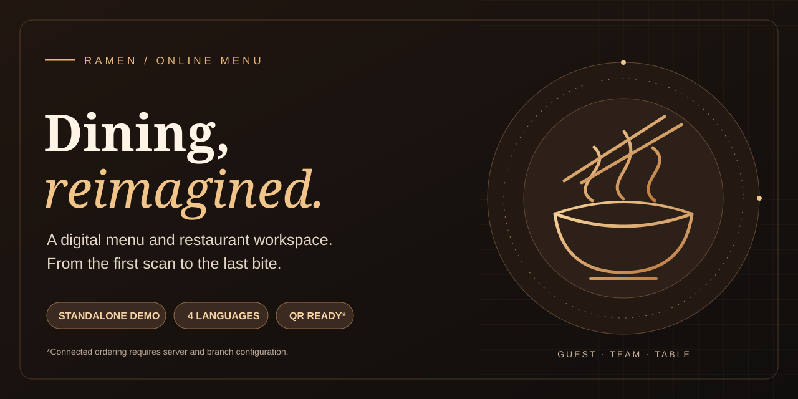

# RAMEN / Flagship library

**One product. Four languages. A clear path from demonstration to operation.**

[English](en.md) · [فارسی](fa.md) · [العربية](ar.md) · [Türkçe](tr.md)

## Choose your path

| Audience | Start here |
| --- | --- |
| Restaurant owner / customer | [Product catalog and demo presentation](PRODUCT.md) |
| Guest or restaurant manager | [EN](en.md) · [FA](fa.md) · [AR](ar.md) · [TR](tr.md) |
| Design and marketing | [Brand guidelines](BRAND.md) |
| Engineer or technical buyer | [System architecture and release gates](ENGINEERING.md) |
| Partner or investor | [Investor briefing](INVESTOR.md) |
| Maintainer | [Release communication](RELEASE.md) |

## See the real product

The [successful Product showcase run](https://github.com/cianium/Online-Menu/actions/runs/45645429531) captured the standalone application at revision `cae5e8158b25dbe585f50573bd652190a96c8937`. Its [ramen-product-showcase artifact](https://github.com/cianium/Online-Menu/actions/runs/45645429531/artifacts/15037840953) includes customer/admin screenshots, an admin GIF, a social preview PNG and capture provenance. GitHub may require sign-in; this artifact expires on 25 December 2026. For a fresh package, use the [showcase instructions](../showcase/README.md).

## Scope

This library describes the vq.3 / 3.0.0 source and standalone demo; it does not certify a production deployment. The four locale guides intentionally share the same feature boundaries. The repository has no selected open-source license. Commercial terms and brand proposals are not approved contracts.

[Back to repository](../../README.md)
